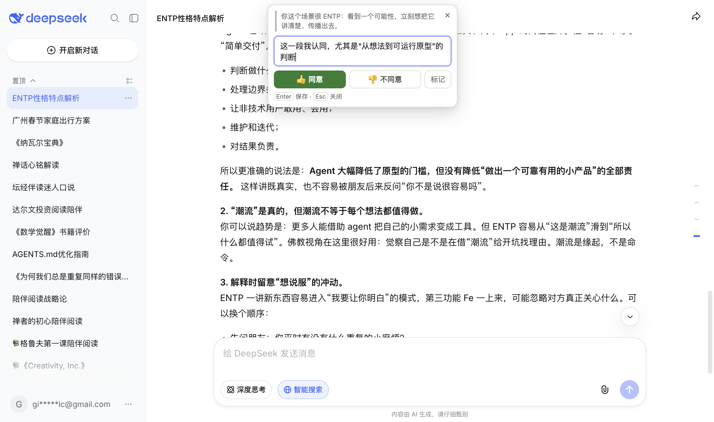

# ds-popup — DeepSeek 网页版批注

在 [chat.deepseek.com](https://chat.deepseek.com/) 里选中助手回复中的文字，卡片就地出现：点「同意」「不同意」「标记」，或直接写一句。回答过的段落最后汇总成引用草稿，写进输入框。

这是 [dsh-popup](https://github.com/GioStarLC/dsh-popup) 的 Chrome 移植版。锚点模型、存储、Markdown 交付格式来自原项目；宿主适配层（如何识别回复、如何写输入框）为 DeepSeek 网页重写。设计取舍见 [docs/design.md](docs/design.md)。

<p align="center"></p>

## 安装

还没上架 Chrome 应用商店，目前从源码加载。Chrome 的「加载已解压的扩展程序」要的是一个本地文件夹，所以先把代码拿到本地：

1. 任选一种：
   - 克隆：`git clone https://github.com/GioStarLC/ds-popup.git`
   - 或在仓库页点 **Code → Download ZIP**，下载后解压
2. 打开 `chrome://extensions`
3. 右上角打开「开发者模式」
4. 「加载已解压的扩展程序」→ 选择包含 `manifest.json` 的那一层目录（克隆出来是 `ds-popup/`，ZIP 解压出来通常是 `ds-popup-main/`，不要再往里点一层）
5. 刷新已经打开的 chat.deepseek.com 页面

更新时重新拉取或重新下载，然后在 `chrome://extensions` 的扩展卡片上点刷新——只刷新网页不会拿到新的 content script。

## 用法

| 你做的 | 它做的 |
| --- | --- |
| 在任意助手回复里选中文字 | 卡片就地出现，光标已在批注框 |
| 键盘选中后按 `Cmd/Ctrl+Shift+Enter` | 同一张卡片 |
| 点 👍 同意 / 👎 不同意 / 标记 | 存进当前会话 |
| 写完按 `Enter`（`Shift+Enter` 换行） | 存成带回答的引用 |
| 点空的输入框 | 待填入的引用自动写进草稿 |
| 点输入框工具行的「填入 N」 | 手动交付 |
| 点「自动」 | 关掉/打开进入输入框时自动填入 |
| 点已标记的段落 | 取消标记；刚填入的内容会一并撤回，可撤销 |

交付到草稿的格式：

```markdown
> 第一步：用 Redis
我的回答：运维成本高
```

`我的回答：` 是格式的一部分：没有它，紧跟在引用后面的普通行会被模型读成引用的延续。

卡片在 `Esc`、右上角 `×`、点外面时关闭；正在写的时候滚动不会把它带走。

## 结构

```
manifest.json        MV3
src/core.js          锚点、定位、存储、Markdown（宿主无关）
src/adapter.js       唯一知道 DeepSeek DOM 的文件
src/card.js          Shadow DOM 卡片
src/content.js       事件接线、高亮、输入框按钮
docs/design.md       为什么这样拆
tools/check.mjs      manifest / 语法 / 宿主边界 / 纯函数断言
```

选择器只集中在 `src/adapter.js`。DeepSeek 改版时只需要改这一处。

## 开发

```sh
npm run check
```

这条检查覆盖四件事：manifest 引用的文件都存在、四个 content script 能编译、除 `adapter.js` 外没有文件提到宿主选择器、核心的纯函数（投影 / 引用块 / 撤回计划）行为正确。

改完 content script 后，在 `chrome://extensions` 点扩展卡片上的刷新，再刷新页面。Chrome 会缓存 content script，只刷新页面不一定能拿到新代码。

### 在真实页面上自测

需要一个已登录的 Chrome，并打开调试端口：

```sh
"/Applications/Google Chrome.app/Contents/MacOS/Google Chrome" \
  --user-data-dir=/tmp/ds-popup-profile \
  --remote-debugging-port=9333 \
  --load-extension="$PWD" --disable-extensions-except="$PWD" \
  https://chat.deepseek.com/
```

然后在页面里选中一段助手回复，确认卡片出现；或直接观察 `localStorage['ds-popup/marks/v1']`。

## 隐私

不联网、不读取会话内容到任何服务器。标记只写本页 `localStorage`，高亮只在本页渲染。扩展没有 background worker，也没有任何远程请求。

## 已知边界

- 页面刷新会清空草稿，但已交付的标记仍记着「已填入」。
- 只覆盖对话正文与输入框；分享页、侧边栏、设置面板不参与。
- 「取消标记」只在草稿仍逐字节等于插入时那一刻才自动撤回；改过草稿就只取消标记，不动你的文字。
- 高亮使用 CSS Custom Highlight API；不支持的浏览器上标记仍可用，只是不上色。

## 许可

[MIT](LICENSE)。非官方扩展，与 DeepSeek 无隶属关系，也未获其背书。“DeepSeek”仅用于说明它所接入的应用。
